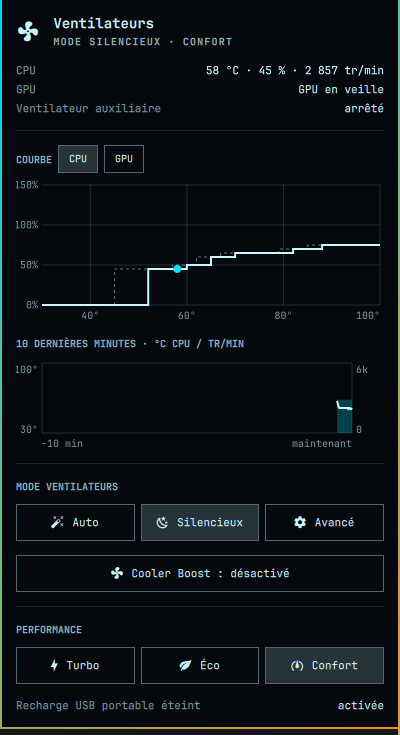

# MSI Fans — widget de barre Omarchy

Modes des ventilateurs, Cooler Boost et mode de performance des portables MSI, sous forme
de widget de barre pour [Omarchy](https://omarchy.org). Il parle directement au pilote
noyau `msi-ec` par sysfs : aucun programme intermédiaire, aucun privilège root à l'exécution.



## Ce qu'il fait

- Température CPU et GPU en direct, vitesse des ventilateurs (pourcentage et tr/min) et
  ventilateur auxiliaire.
- Courbe des ventilateurs (CPU et GPU) avec le point de fonctionnement en direct.
- Historique sur dix minutes de la température CPU et des tr/min.
- Boutons pour le mode des ventilateurs (auto, silencieux, avancé), le Cooler Boost
  (aussi au clic droit sur l'icône de la barre) et le mode de performance (shift mode).
- L'icône de la barre tourne à une vitesse proportionnelle aux tr/min du ventilateur CPU.
- Affiche « GPU absent » si le portable n'a pas de GPU NVIDIA, et « GPU en veille »
  seulement quand le GPU est réellement suspendu.
- Si une écriture est refusée, le panneau l'indique (par exemple si vous ne vous êtes pas
  reconnecté après votre ajout au groupe `msi-ec`).

## Prérequis

- Un portable MSI avec le pilote `msi-ec` corrigé de
  [msi-gs76-linux](https://github.com/swald54000/msi-gs76-linux), correctif 1 (pilote et
  règle udev).
- Votre utilisateur dans le groupe `msi-ec` (le correctif l'y ajoute ; reconnectez-vous
  ensuite). La règle udev donne à ce groupe l'écriture dans les fichiers sysfs du pilote.
- Omarchy.

## Installation

```sh
omarchy plugin add https://github.com/swald54000/omarchy-msi-fans.git --enable
```

Ajoutez ensuite le widget « swald.fans » à votre barre.

## Désinstallation

```sh
omarchy plugin remove swald.fans
```

## Tests

La logique du widget (`Model.js`) ne dépend pas de Qt et se teste avec Node :

```sh
node --test tests/
```

## Langue

L'interface est en français.

## À voir aussi

[KLC Light](https://github.com/swald54000/klc-light) : éditeur d'éclairage par touche du
clavier des mêmes portables.

## Licence

MIT, voir `LICENSE`.
