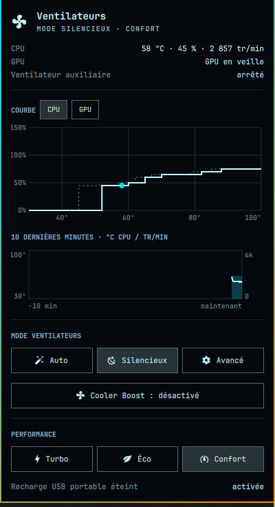

# MSI Fans — Omarchy bar widget

Fan modes, Cooler Boost and performance mode for MSI laptops, as a bar widget for
[Omarchy](https://omarchy.org). It talks to the `msi-ec` kernel driver directly through
sysfs: no helper program and no root privileges at run time.



## What it does

- Live CPU and GPU temperature, fan speed (percent and rpm) and auxiliary fan.
- Fan curve chart (CPU and GPU) with the live operating point.
- Ten-minute history of CPU temperature and fan rpm.
- Buttons for the fan mode (auto, silent, advanced), Cooler Boost (also on right click
  of the bar icon) and the performance mode (shift mode).
- The bar icon spins at a speed proportional to the CPU fan rpm.
- Says "GPU absent" when the laptop has no NVIDIA GPU, and "GPU en veille" (asleep) only
  when the GPU really is suspended.
- If a write is refused, the panel says so (for example when you have not logged out and
  back in after joining the `msi-ec` group).

## Requirements

- An MSI laptop running the patched `msi-ec` driver from
  [msi-gs76-linux](https://github.com/swald54000/msi-gs76-linux), fix 1 (driver and udev
  rule).
- Your user in the `msi-ec` group (the fix adds it; log out and back in afterwards). The
  udev rule gives that group write access to the driver's sysfs files.
- Omarchy.

## Install

```sh
omarchy plugin add https://github.com/swald54000/omarchy-msi-fans.git --enable
```

Then add the "swald.fans" widget to your bar.

## Remove

```sh
omarchy plugin remove swald.fans
```

## Tests

The widget logic (`Model.js`) has no Qt dependency and is tested with Node:

```sh
node --test tests/
```

## Language

The interface text is in French.

## See also

[KLC Light](https://github.com/swald54000/klc-light): per-key keyboard lighting editor
for the same laptops.

## License

MIT, see `LICENSE`.
